<div align="center">

# Frigus Web

Aplicação web do **Frigus** para organizar alimentos, compras, receitas e operações de estabelecimentos.
Interface construída com React, TypeScript e Vite, integrada ao BFF e às APIs do ecossistema Frigus.


</div>

---

## O que é o Frigus Web

O Frigus Web é a aplicação de navegador do Frigus. A interface adapta os módulos e a navegação ao tipo de conta, e encaminha as operações de negócio para o backend por meio do BFF (Backend for Frontend).

### Áreas do produto

| Área | Recursos disponíveis |
|---|---|
| **Doméstica** | Painel inicial, estoque e validade dos alimentos, alertas, receitas, lista de compras, membros da família, conversas, perfil, notificações e planos. |
| **Comercial** | Estoque e lotes, validades, lista de compras, despesas, desperdícios, funcionários e relatórios. |
| **Empresarial** | Visão geral, anúncios de produtos, audiência, visualizações e relatórios. |
| **Conta e pagamentos** | Cadastro, login, recuperação de senha, seleção do perfil e fluxo de checkout/webview. |

Além das áreas principais, a aplicação inclui um chat de suporte e um chat com o assistente de IA. Rotas protegidas verificam a sessão e o tipo de conta antes de abrir cada módulo.

### Cadastro, escolha de plano e pagamento

O cadastro começa pela escolha do tipo de conta. Em seguida, o usuário escolhe um plano ativo compatível com esse tipo. O plano gratuito é ativado diretamente; planos pagos seguem para o checkout e liberam o acesso após a aprovação da transação. Se o usuário sair antes de concluir, o login retoma a escolha do plano ou o pagamento pendente.

O catálogo e os valores vêm da Core API por meio do BFF. O checkout atual é demonstrativo: os métodos e os dados de pagamento não processam cobranças reais. A conclusão da compra depende do estado da transação retornado pela API.

### Acessibilidade

O painel global de acessibilidade permite aumentar o tamanho do texto, ativar alto contraste e usar a fonte OpenDyslexic. As preferências são salvas no navegador. A navegação inclui um atalho para pular ao conteúdo, foco visível para teclado, foco no conteúdo após mudanças de rota e fechamento do painel com `Esc`.

---

## Arquitetura

O navegador não acessa os bancos de dados diretamente. Os serviços da interface chamam o BFF; o BFF coordena as APIs de backend e os serviços associados.

```mermaid
flowchart LR
    subgraph WEB["Frigus Web — navegador"]
        ENTRY["main.tsx<br/>React + CSS global"] --> APP["App.tsx<br/>providers e sessão"]
        APP --> ROUTER["React Router"]
        ROUTER --> GUARD["AuthGuard<br/>sessão e tipo de conta"]
        GUARD --> PAGES["Páginas e layouts<br/>doméstico, comercial,<br/>empresarial e conta"]
        PAGES --> SERVICES["services/<br/>casos de uso HTTP"]
        SERVICES --> API["utils/api.util.ts<br/>Axios + validação Zod"]
    end

    API -->|"VITE_API_URL<br/>cookies de sessão"| PROXY["Nginx / proxy /api<br/>em Docker"]
    PROXY --> BFF["Frigus BFF<br/>frigus-bff"]
    BFF --> CORE["Frigus Core API<br/>frigus-core-api"]
    BFF --> SUPA["Supabase<br/>integrações do BFF"]
    CORE -->|"chat com IA"| AI["Frigus AI API<br/>frigus-ai"]
```



### Fluxo de uma requisição

1. A página chama uma função de domínio em `src/services/`.
2. `src/utils/api.util.ts` envia a requisição com Axios, usando `VITE_API_URL` como base e `withCredentials` para enviar cookies.
3. Em desenvolvimento local com Docker, o Nginx do frontend encaminha `/api/*` ao BFF e remove o prefixo `/api` antes de encaminhar.
4. O BFF conversa com o Core API e com as integrações configuradas no servidor.
5. Os serviços validam os dados de entrada e de resposta usando schemas Zod antes de entregá-los às páginas.

Quando uma chamada protegida recebe `401`, a camada HTTP tenta renovar a sessão uma vez por meio de `/web/auth/refresh`. Chamadas simultâneas compartilham a mesma tentativa de renovação; se ela falhar, a sessão local é encerrada.

### Estado e sessão

- **Zustand** mantém em memória o usuário autenticado e o estado de inicialização da sessão.
- Ao abrir a aplicação, o frontend chama `refreshSession()` para restaurar uma sessão existente.
- As chamadas HTTP usam cookies de sessão (`withCredentials`); tokens de autenticação não são persistidos no `localStorage` pelo store.
- Preferências de acessibilidade são uma exceção funcional e ficam em `localStorage`, separadas da autenticação.
- Ações de rede são organizadas em serviços por domínio, mantendo detalhes HTTP fora das páginas.

---

## Estrutura do projeto

```text
frigus-react-web/
├── public/
│   └── licenses/              # Licenças de ativos redistribuídos, como OpenDyslexic
├── src/
│   ├── App.tsx                # Providers, roteador e inicialização da sessão
│   ├── main.tsx               # Entrada React e CSS global
│   ├── global.css             # Tailwind, temas, tipografia e acessibilidade
│   ├── assets/                # Logos e recursos visuais
│   ├── components/            # Layouts, navegação, formulários, modais e UI compartilhada
│   ├── contexts/              # Sessão, tema e preferências de acessibilidade
│   ├── hooks/                 # Hooks reutilizáveis
│   ├── pages/
│   │   ├── Auth/               # Login e cadastro
│   │   ├── Common/             # Recuperação de senha, planos e escolha de perfil
│   │   ├── Domestic/           # Módulos domésticos
│   │   ├── Commercial/         # Módulos comerciais
│   │   ├── Enterprise/         # Módulos empresariais
│   │   └── Payment/            # Checkout e webviews de pagamento
│   ├── routes/                 # Rotas por área, guards, aliases e layouts de workspace
│   ├── schemas/                # Schemas Zod de formulários e contratos HTTP
│   ├── services/               # Chamadas de API agrupadas por domínio
│   ├── store/                  # Store Zustand e slice de autenticação
│   ├── types/                  # Tipos TypeScript compartilhados
│   └── utils/                  # Cliente HTTP, validação, URLs e classes CSS
├── tests/                      # Testes de contratos e contratos live opcionais
├── .github/workflows/ci.yaml   # CI: npm ci, lint e build
├── Dockerfile                  # Build multi-stage Node + Nginx
├── nginx.conf                  # SPA fallback e proxy /api para o BFF
├── package.json                # Scripts e dependências diretas
├── package-lock.json           # Versões resolvidas para instalação reproduzível
├── tsconfig*.json              # Configurações TypeScript por contexto
└── vite.config.ts              # Plugins Vite e alias @ → src/
```

As páginas são carregadas sob demanda por `src/routes/lazyPage.tsx`, que mostra um indicador durante o carregamento do módulo. Os layouts compartilhados ficam em `src/components/` e `src/routes/WorkspaceLayout.tsx` escolhe o layout da área atual.

---

## Rotas principais

| Grupo | Rotas de exemplo | Acesso |
|---|---|---|
| Autenticação | `/login`, `/register`, `/forgot-password`, `/recover-password/step-1` | Público |
| Doméstico | `/home`, `/stock`, `/alerts`, `/recipe`, `/shopping-list`, `/chat`, `/chat-ai`, `/settings` | Sessão doméstica, conforme rota |
| Comercial | `/commercial/stock`, `/commercial/validity`, `/commercial/expenses`, `/commercial/employees` | Conta comercial |
| Empresarial | `/enterprise`, `/enterprise/ads`, `/enterprise/views`, `/enterprise/report` | Conta empresarial |
| Pagamento | `/checkout`, `/checkout/webview`, `/checkout/webview/success` | Sessão autenticada |

As rotas completas estão definidas em `src/routes/`. A rota `/` encaminha o usuário para a área correspondente ao tipo de conta. `AuthGuard` preserva o destino ao redirecionar sessões ausentes para o login e impede o acesso a áreas de outro tipo de conta.

---

## Dependências

As versões abaixo são os intervalos declarados em `package.json`. O `package-lock.json` registra as versões exatas resolvidas para o projeto.

### Dependências da aplicação

| Pacote | Versão | Responsabilidade |
|---|---:|---|
| `@aejkatappaja/phantom-ui` | `^0.10.1` | Biblioteca de componentes de interface disponível no projeto. |
| `@hookform/resolvers` | `^5.4.0` | Adaptadores de validação para React Hook Form. |
| `@tailwindcss/vite` | `^4.3.0` | Integração do Tailwind CSS 4 com o Vite. |
| `@tanstack/react-query` | `^5.100.14` | Cache e sincronização de estado remoto. |
| `axios` | `^1.16.1` | Cliente HTTP usado pelos serviços da aplicação. |
| `class-variance-authority` | `^0.7.1` | Definição de variantes tipadas para componentes. |
| `clsx` | `^2.1.1` | Composição condicional de classes CSS. |
| `immer` | `^11.1.18` | Atualização imutável do estado Zustand. |
| `lucide-react` | `^1.33.0` | Ícones SVG para a interface. |
| `open-dyslexic` | `^1.0.3` | Arquivos locais da fonte OpenDyslexic usada pela opção de acessibilidade. |
| `react` | `^19.2.6` | Biblioteca de componentes da interface. |
| `react-dom` | `^19.2.6` | Renderização React no navegador. |
| `react-hook-form` | `^7.76.1` | Gerenciamento de formulários. |
| `react-loading-skeleton` | `^3.5.0` | Placeholders de carregamento. |
| `react-router-dom` | `^7.16.0` | Rotas, navegação e layouts aninhados. |
| `tailwind-merge` | `^3.6.0` | Remove conflitos entre utilitários Tailwind combinados. |
| `tailwindcss` | `^4.3.0` | Sistema de estilos utilitários. |
| `zod` | `^4.4.3` | Validação de formulários, payloads e respostas da API. |
| `zustand` | `^5.0.14` | Estado global leve para autenticação e sessão. |

### Dependências de desenvolvimento

| Pacote | Versão | Responsabilidade |
|---|---:|---|
| `@commitlint/cli` | `^21.0.2` | Validação de mensagens de commit. |
| `@commitlint/config-conventional` | `^21.0.2` | Regras Conventional Commits para Commitlint. |
| `@eslint/js` | `^10.0.1` | Configuração base do ESLint. |
| `@types/node` | `^24.13.3` | Tipos Node usados pela configuração e ferramentas. |
| `@types/react` | `^19.2.14` | Tipos TypeScript para React. |
| `@types/react-dom` | `^19.2.3` | Tipos TypeScript para React DOM. |
| `@vitejs/plugin-react` | `^6.0.1` | Transformação e suporte React no Vite. |
| `commitlint` | `^21.0.2` | Execução das regras de commit. |
| `eslint` | `^10.3.0` | Análise estática do código. |
| `eslint-plugin-react-hooks` | `^7.1.1` | Regras de lint para hooks React. |
| `eslint-plugin-react-refresh` | `^0.5.2` | Regras de compatibilidade com Fast Refresh. |
| `globals` | `^17.6.0` | Definições de variáveis globais para ESLint. |
| `husky` | `^9.1.7` | Hooks Git locais. |
| `typescript` | `~6.0.2` | Compilador e verificação de tipos. |
| `typescript-eslint` | `^8.59.2` | Integração de TypeScript com ESLint. |
| `vite` | `^8.0.12` | Servidor de desenvolvimento e bundler. |
| `vitest` | `^4.1.8` | Execução dos testes de contrato. |

> **Nota sobre o manifesto:** `@aejkatappaja/phantom-ui`, `@hookform/resolvers`, `@tanstack/react-query`, `class-variance-authority` e `react-hook-form` estão declarados, mas não têm import direto identificado em `src/` no momento desta documentação. React Query e React Hook Form podem ser adotados por novas telas sem alterar a arquitetura geral.

---

## Configuração local

### Requisitos

- Node.js `20.19+` ou `22.12+` (a imagem Docker usa Node 22).
- npm, incluído na instalação do Node.js.
- A API do BFF Frigus acessível pelo navegador.

### Instalar e iniciar

```bash
npm ci
```

Crie um arquivo `.env` na raiz do frontend. Para apontar diretamente ao BFF local:

```env
VITE_API_URL=http://localhost:3001
```

O `.env.example` usa `http://localhost:3000`, a porta padrão do BFF executado diretamente. Na stack Docker Compose, o build define `VITE_API_URL=/api`; o Nginx encaminha esse caminho ao BFF publicado em `http://localhost:3001`. Como o valor é embutido no build, escolha a URL antes de gerar o bundle.

O botão **Entrar com Google** requer um OAuth Client ID do tipo aplicação Web configurado em `VITE_GOOGLE_CLIENT_ID` no frontend e `GOOGLE_CLIENT_ID` na Core API. Use o mesmo ID nos dois lados e cadastre a origem local do frontend nas origens JavaScript autorizadas do cliente Google. No Docker Compose, preencha `GOOGLE_CLIENT_ID` em `.env.compose`; sem esse valor o botão informa que o login ainda não está configurado.

Inicie o servidor de desenvolvimento:

```bash
npm run dev
```

O Vite imprime o endereço local ao iniciar (por padrão, `http://localhost:5173`). Para desenvolver contra a stack completa, use o Docker Compose da pasta pai; o frontend passa a usar `/api` e o Nginx encaminha as chamadas ao BFF.

Consulte [`../LOCAL-STACK.md`](../LOCAL-STACK.md) e [`../.env.compose.example`](../.env.compose.example) para configurar a stack integrada com BFF, Core API, bancos e Frigus AI. O arquivo `.env.compose` contém segredos locais e não deve ser commitado.

### Comandos

| Comando | Ação |
|---|---|
| `npm run dev` | Inicia o Vite com atualização rápida (HMR). |
| `npm run build` | Verifica os projetos TypeScript e cria o bundle de produção em `dist/`. |
| `npm run preview` | Serve localmente o bundle de `dist/` para inspeção. |
| `npm run lint` | Executa ESLint no projeto. |
| `npm run test` | Executa a suíte Vitest uma vez. |

### Testes

`tests/contracts.test.ts` verifica se os schemas do frontend mantêm compatibilidade com os schemas do BFF e cobre payloads opcionais e regras de validação. Execute com:

```bash
npm run test
```

Esse teste importa schemas de `../frigus-bff`, portanto o repositório do BFF precisa estar ao lado deste diretório para rodar a suíte completa.

`tests/contracts.live.test.ts` contém verificações contra a stack Docker local. Elas ficam desabilitadas por padrão e só rodam com `RUN_STACK_CONTRACTS=1`. Precisam de um BFF/Core API local, Docker e credenciais de uma conta de demonstração local (`FRIGUS_TEST_EMAIL` e `FRIGUS_TEST_PASSWORD`). `FRIGUS_STACK_URL` pode apontar para a URL local da API; por padrão é `http://127.0.0.1:5173/api`. Esse fluxo cria e altera dados de teste no banco local; não aponte-o para produção.

### Verificações automatizadas

O workflow de CI em [`.github/workflows/ci.yaml`](.github/workflows/ci.yaml) instala dependências com `npm ci` e executa `npm run lint` e `npm run build`. A etapa de testes Vitest está definida no workflow, mas atualmente comentada.

---

## Build e execução com Docker

O `Dockerfile` usa duas etapas:

1. **Build:** Node 22 Alpine, instalação reproduzível com `npm ci` e execução de `npm run build`.
2. **Runtime:** Nginx Alpine serve os arquivos estáticos de `dist/`, aplica fallback de SPA para `index.html` e encaminha `/api/` ao serviço `bff:3000`.

Na stack local, o frontend é servido em `http://localhost:5173`. A configuração de `VITE_API_URL` é embutida durante o build, então ajuste-a no argumento de build da imagem, não apenas nas variáveis do container em execução.

Para subir todos os serviços integrados, execute da pasta do repositório principal:

```bash
docker compose --env-file .env.compose up --build
```

---

## Desenvolvimento

- Preserve a separação entre páginas, serviços de domínio, schemas e utilitários HTTP.
- Ao alterar payloads, confira os schemas correspondentes em `src/schemas/` e os contratos do BFF.
- Use `npm run lint` e `npm run build` antes de abrir um pull request.
- Os componentes compartilhados ficam em `src/components/`; layouts de cada área compõem esses componentes.
- O alias `@/` aponta para `src/` tanto no Vite quanto no TypeScript.

---

## Tecnologias relacionadas

- **BFF:** [`../frigus-bff`](../frigus-bff/) — API do frontend e ponto de entrada para os serviços de backend.
- **Core API:** [`../frigus-core-api`](../frigus-core-api/) — regras de negócio e dados principais do Frigus.
- **Assistente:** [`../frigus-ai`](../frigus-ai/) — API do assistente de IA.
- **Stack local:** [`../docker-compose.yml`](../docker-compose.yml) e [`../LOCAL-STACK.md`](../LOCAL-STACK.md).
