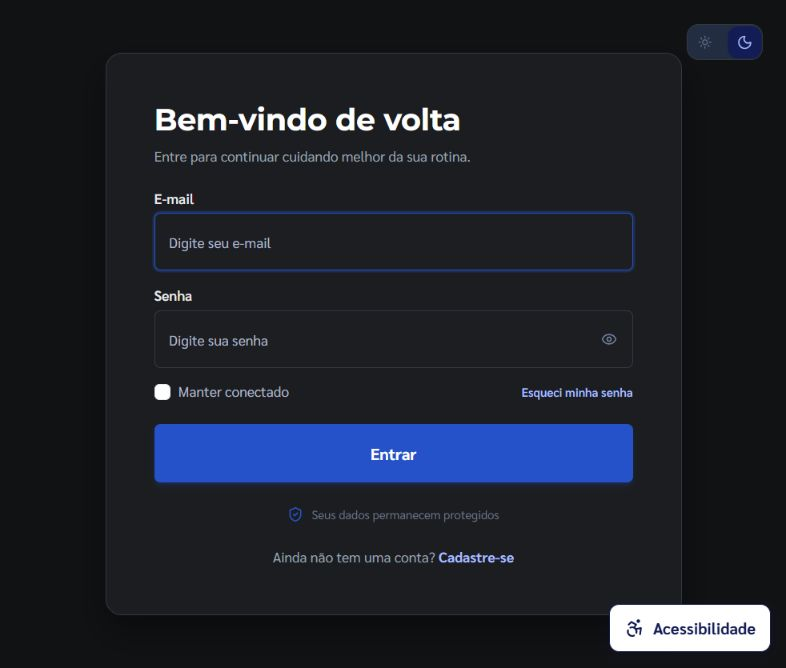

# Auditoria técnica — React, TypeScript e AppSec

Data: 29/10/2026, America/Sao_Paulo. Escopo: `frigus-react-web`, sobre os arquivos locais existentes no início da sessão. Foram inspecionados os pontos de entrada, rotas, 173 arquivos TypeScript/TSX, serviços, schemas, componentes compartilhados, efeitos e configuração de publicação. BFF e Core foram consultados para conferir contratos; não receberam alterações. Os outros projetos do workspace não foram auditados integralmente.

As alterações locais anteriores foram preservadas. O inventário em `audit/changed-files.json` compara o código ao snapshot feito no início desta sessão, pois o Git já continha uma refatoração extensa em andamento. Os testes acrescentados e `.env.example` complementam esse inventário.

## 1. Sumário executivo

**Diagnóstico:** há boas bases — React escapa conteúdo textual, autenticação por cookies HttpOnly, respostas majoritariamente validadas com Zod e divisão de código por rota. Foram corrigidos problemas verificáveis de dependências, proteção HTTP, concorrência, recuperação de erros e acessibilidade. O projeto completo ainda tem pendências de produto, paginação e validação WCAG antes de uma liberação de produção.

| Criticidade | Principais achados | Situação |
| --- | --- | --- |
| Alta | Cinco pacotes sinalizados pelo registro npm: dois com classificação alta e três moderada; ausência de proteção HTTP contra enquadramento | Dependências corrigidas e cabeçalhos publicados em container de verificação |
| Média | Mistura de mensagens entre conversas; logout por falhas de rede/HTTP 500; bootstrap antigo sobrescrevendo login; falta de cancelamento; falhas silenciosas no dashboard; acesso por teclado e foco inconsistentes | Correções aplicadas e cenários críticos cobertos por testes |
| Média | Paginação truncada, métricas empresariais fixas, controles sem ação e contraste inconsistente em telas não verificadas integralmente | Pendências discriminadas abaixo |
| Baixa | Estado redundante, identidade de contexto instável, modo estrito não declarado e comentários que repetiam o JSX | Correções aplicadas; removidos 263 comentários de seção em JSX |

## 2. Apontamentos detalhados e correções

As linhas abaixo referem-se ao código **corrigido**. A descrição registra o comportamento anterior e a razão da mudança.

### Segurança e vulnerabilidades

**[Alta, corrigido] Dependências com avisos publicados.** `package.json:32`, `package-lock.json`. A auditoria inicial apontou Zod e follow-redirects como altos, e Vitest, @vitest/mocker e fast-uri como moderados. As versões resolvidas passaram a Zod **4.6.7**, follow-redirects **1.16.2**, Vitest/@vitest/mocker **4.1.12** e fast-uri **3.1.9**. Os mínimos de Zod e Vitest também foram elevados no manifesto. `npm audit fix --ignore-scripts` foi usado sem `--force` e sem migração de major.

A classificação do registro não comprova exploração nesta aplicação. O caso de follow-redirects envolve o adaptador Node; não representa automaticamente vazamento no adaptador HTTP do navegador. Os contextos estão descritos nos avisos de [Zod](https://github.com/advisories/GHSA-mrhx-c7xc-m3w5), [follow-redirects](https://github.com/advisories/GHSA-q3jh-wrc6-jgq8), [Vitest](https://github.com/advisories/GHSA-qxg6-89mg-rqv8) e [fast-uri](https://github.com/advisories/GHSA-w74x-v6f9-j3xg).

**[Alta, corrigido] Proteção contra enquadramento ausente.** `nginx.conf:8`. Foram acrescentados `X-Frame-Options: DENY`, CSP com `frame-ancestors 'none'`, `object-src 'none'`, `base-uri`, `form-action`, `nosniff`, política de referrer e permissões restritas. A sintaxe foi validada por `nginx -t`; um container temporário serviu `/login` com HTTP 200 e os cinco cabeçalhos esperados. O container foi removido após a verificação. A proteção depende de publicar com esta configuração ou reproduzi-la na hospedagem efetiva. A CSP permite estilos inline usados pelos componentes, Google Fonts, imagens HTTP/HTTPS e APIs HTTPS; não deve ser descrita como uma allowlist estrita de todos os hosts.

**[Baixa, corrigido] Hardening explícito dos links.** `src/components/AdvertisementShelf/index.tsx`. O link já tinha `noreferrer`, que protege a referência ao opener nos navegadores atuais. Foi acrescentado `noopener` explicitamente conforme o requisito; não foi classificado como tabnabbing comprovado. Os anexos do chat já usavam ambos. URLs de fotos do estoque e dos detalhes passaram pelo mesmo `safeHttpUrl` usado nos anúncios/anexos. Os testes recusam `javascript:`, `data:`, `vbscript:` e `file:`.

**Sem achado de sink HTML inseguro no escopo.** Não foram encontrados `dangerouslySetInnerHTML`, `innerHTML` ou iframes em `src`. Conteúdo do chat continua sendo renderizado como texto escapado por React. Isso não substitui verificação de conteúdo servido por uploads no backend.

**Sem segredo confirmado no frontend atual.** A busca em fontes, testes e exemplo de ambiente não encontrou os padrões de chaves privadas/tokens pesquisados. O `.env` atual foi classificado sem expor valores; somente `.env.example` está versionado entre os arquivos de ambiente do frontend. Não há persistência atual de tokens em localStorage/sessionStorage: o store mantém a sessão em memória e remove o armazenamento legado. Preferências visuais não são segredos. Toda variável `VITE_*` deve ser tratada como pública. Não houve varredura de todo o histórico Git ou dos demais repositórios; o resultado não certifica ausência histórica de vazamentos.

### Contratos, rede e estado

**[Média, corrigido] Logout indevido e perda da causa HTTP.** `src/utils/api.util.ts:14`, `:32`, `:66`, `:82`. O `catch` anterior englobava renovação e repetição da requisição: um HTTP 500 na repetição, uma falha de rede ou um cancelamento disparavam `frigus:session-expired` e eram substituídos pelo 401 original. Agora `ApiError` preserva status/cause, a mensagem recebida é conferida em runtime, cancelamentos mantêm sua identidade e somente rejeição de autenticação encerra a sessão. Consumidores compartilham a renovação, mas podem cancelar sua própria espera. O retry é limitado a uma tentativa.

**[Média, corrigido] Bootstrap antigo substituindo login recente.** `src/App.tsx:19`, `src/store/auth.slice.ts`. O resultado da renovação inicial era publicado sem verificar desmontagem ou mudança de sessão. Login/logout agora marcam a inicialização de forma atômica. O bootstrap publica somente se o consumidor continua montado e a sessão ainda não foi inicializada. O compartilhamento da operação evita duplicação pelo StrictMode. Testes cobrem login recente e desmontagem.

**[Média, corrigido] Mensagens da conversa A exibidas na B.** `src/hooks/useFamilyChat.ts:25`, `:40`, `src/pages/Domestic/Chat/index.tsx`. O envio capturava uma conversa e, ao resolver, acrescentava sua resposta ao único array de mensagens, mesmo após a seleção de outra conversa. A lógica foi extraída para um hook; leituras/envios recebem AbortSignal, respostas canceladas são ignoradas e mensagens locais são associadas ao identificador da conversa. Loading de mensagens, vazio e erro são separados. Controles sem implementação de anexo/emoji/menu foram removidos desse formulário. O teste simula um transporte que entrega a resposta mesmo depois do cancelamento.

**[Média, corrigido] Requisições sobrevivendo à tela ou vencendo recargas recentes.** `src/hooks/useLatestRequest.ts:3`, `src/hooks/useAbortableAsync.ts:9`, serviços e páginas consumidoras. AbortSignal foi propagado até Axios nas leituras de estoque, anúncios, receitas, equipe, perfil, notificações, relatórios e listas. Os sete loaders reutilizados por ações cancelam a operação anterior e ignoram commits obsoletos. O chat IA cancela a geração ao sair, evita envio concorrente e respeita redução de movimento. Timers de feedback de configurações e reenvio de código recebem cleanup. Cancelar uma requisição de escrita no navegador não desfaz uma transação que o servidor já confirmou.

**[Média, corrigido] Erro apresentado como ausência de dados.** `src/pages/Domestic/Home/index.tsx:22`, `:51`. Falhas da lista de compras e de produtos recentes eram convertidas em arrays vazios, gerando mensagens como “lista em dia”. Cada recurso agora tem erro visível próprio; requisições são canceladas na desmontagem. O fallback fixo de nome de usuário foi removido.

**[Média, corrigido] Payload incompleto aceito como página vazia.** `src/services/chat.service.ts`, `src/services/inventory.service.ts`. O campo `content` de mensagens e movimentações deixou de ser opcional. `src/schemas/api-response.schema.ts:112` também valida os seis estados de transação do enum real do Core, impedindo que um status desconhecido produza uma espera sem diagnóstico. `unknown` continua sendo validado antes de virar um DTO. Não foram encontrados usos explícitos de `any` no código TypeScript; a ocorrência `step="any"` é atributo HTML.

**[Média, corrigido] Estado local de uma entidade reaproveitado por outra.** `src/pages/Domestic/RecipeDetails/index.tsx:11`, detalhes de lote e status de transação. Uma receita modificada localmente podia continuar aparecendo ao mudar o parâmetro da rota. Esses conteúdos agora reiniciam seu estado pelo ID; o polling de transação também é encerrado ao trocar de ID.

**[Média, corrigido] Chaves herdadas tratadas como entradas de catálogo.** `src/routes/index.tsx:39`, `src/pages/Payment/CheckoutPage/index.tsx:112`. Consultas como `plan=__proto__` podiam selecionar propriedades herdadas de objetos comuns e quebrar o render ao acessar detalhes do plano. As consultas usam `Object.hasOwn` antes de selecionar aliases/planos. Trata-se de lookup incorreto; não foi identificado um mecanismo de escrita que caracterizasse poluição de protótipo.

### Performance e ciclo de vida

**[Baixa, corrigido] Estado redundante provocando nova busca.** `src/pages/Domestic/Stock/index.tsx:81`. O primeiro estoque era copiado para estado, alterava a identidade do callback dependente e executava outra busca. O ID agora deriva do contexto, pois não havia uma seleção independente no componente. O contador de IDs do chat IA foi movido para ref; o valor do AuthContext foi estabilizado com `useMemo`. Não foram adicionados `memo`/`useCallback` indiscriminados a cada função de JSX.

**Divisão por rota preservada.** As páginas já usavam `React.lazy` e `Suspense`. Foi incluído `ErrorBoundary` tanto no shell quanto nas rotas para recuperar falhas de renderização/importação. Um boundary não captura automaticamente rejeições de promessas em handlers: esses caminhos continuam tratados pelos hooks/serviços.

**Limite da análise de performance.** Não foi executado profiling de CPU nem medição de Core Web Vitals em produção. Listas com até 100 itens não justificam automaticamente uma biblioteca de virtualização. O problema comprovado é a paginação descrita nas pendências; quando houver histórico extenso e paginação/scroll incremental, deve-se medir custo de DOM e preservar navegação/leitura assistiva antes de escolher a virtualização.

### Acessibilidade

**[Média, corrigido] Seleção dependente de mouse.** `src/pages/Domestic/Chat/index.tsx:69`, `src/components/Modal/ModalItemList/index.tsx:51`. Conversas passaram de div com clique a botão com estado selecionado; alimentos passaram a checkbox nativo. Campos e envio do chat receberam nomes acessíveis; o histórico usa `role="log"`.

**[Média, corrigido] Focus trap incompleto.** `src/hooks/useModalFocus.ts:20`, `:51`. A lista de foco incluía controles invisíveis. O hook filtra invisíveis/desabilitados, contém foco programático, mantém uma pilha para que apenas o modal superior responda a Escape/Tab e restaura o scroll ao fechar a última janela. Botões de fechar das duas bases de modal receberam nome. Testes verificam o ciclo de foco, restauração e modais simultâneos.

**[Média, corrigido] Link de salto sem destino após lazy loading.** `src/components/AccessibilityTools/index.tsx:31`, layouts e páginas com landmark principal. O efeito procurava o main antes de ele ser renderizado. Os IDs/tabIndex passaram a ser declarativos, o checkout deixou de aninhar main e a mudança de rota aguarda o landmark quando necessário. No navegador, Enter no link levou o foco a `main-content`; a tela de entrada a 390×844 não teve overflow horizontal. O popover de notificações também teve sua largura limitada ao viewport.

**[Média, corrigido] Mensagens de campo sem associação e preferências com IDs repetidos.** `src/components/Input/index.tsx:62`, `src/pages/Domestic/Settings/index.tsx:156`. IDs gerados, `aria-invalid` e `aria-describedby` relacionam campo, ajuda e erro. Os toggles de preferências receberam IDs distintos e nome; o formulário aguarda o carregamento antes de aceitar alterações. As cores dos textos de Checkbox/placeholder do Input passaram a usar o token de texto secundário.

**[Média, corrigido] Aplicação interrompida por storage bloqueado.** `src/contexts/ThemeProvider.tsx:4`. Tanto getItem quanto setItem podiam lançar SecurityError fora do tratamento. Leitura/gravação agora são opcionais; o tema continua em memória. O teste bloqueia ambas as operações e confirma que a troca de tema funciona.

### Manutenibilidade

**[Baixa, corrigido] Comentários que repetiam estrutura visível.** Foram removidos 263 comentários JSX de seção e comentários como numeração de gráficos, “Auto-focus next input” e “Compound component pattern attachment”. Comentários que explicam exceções de compatibilidade, armazenamento indisponível e compartilhamento de renovação foram preservados. A remoção não alterou textos de produto ou regras de negócio.

**[Baixa, corrigido] Garantia de compilação estrita não explícita.** `tsconfig.app.json` agora declara `strict: true`, também herdado pela configuração dos testes. O código existente já passou na checagem estrita preliminar; não foram inventados erros de tipagem inexistentes. A supressão de exhaustive-deps do hook assíncrono foi eliminada ao tornar o carregador uma dependência estável explícita.

**[Baixa, corrigido] Coleta de cartão em componente legado.** `src/pages/Payment/WebViewPayment/index.tsx`. O componente antigo pedia cartão/CVV e navegava após um timer. A conferência de `payment.routes.tsx` mostrou que ele **já não era usado pelas rotas ativas**, que apontavam ao checkout de demonstração. O legado agora redireciona ao mesmo checkout. Não foi relatada coleta ativa de cartão nem cobrança real.

## 3. Pendências antes de uma liberação completa

1. **[Média] Paginação e histórico incompletos.** `src/services/inventory.service.ts:58`, `:82`, `src/services/recipe.service.ts:31`, despesas, anúncios e notificações usam limites fixos sem disponibilizar as páginas seguintes. Filtros/resumos locais não podem representar todo o conjunto quando ele ultrapassa o limite. O chat agora exibe as 100 mensagens mais recentes, em ordem cronológica, e informa esse limite; não oferece ainda navegação pelo histórico anterior. Correção de produto: preservar metadados `totalElements/totalPages`, adicionar cursor/página e separar totais do backend de contagens da página atual.

2. **[Média] Métricas empresariais ilustrativas apresentadas como reais.** `src/pages/Enterprise/MonthlyReport/index.tsx:32`, `:53` e `src/pages/Enterprise/Audience/index.tsx:34` contêm valores fixos e a afirmação “Atualizado hoje com dados consolidados”. Não há consulta de dados nessas telas. É necessário integrar endpoints autorizados com loading/empty/error ou identificar explicitamente a demonstração antes de publicá-las como relatório operacional. Nenhum endpoint ou dado comercial foi inventado nesta auditoria.

3. **[Média] Controles sem implementação.** Exemplo: `src/pages/Domestic/Settings/index.tsx:210`, botão “Excluir minha conta” sem handler. É preciso implementar o fluxo real com autenticação/recuperação adequada ou indicar indisponibilidade. Um botão desenhado não comprova funcionalidade. A integração de pagamentos permanece de demonstração, conforme a própria tela.

4. **[Média] WCAG AA ainda não certificada.** `src/pages/Domestic/Profile/index.tsx:59` e várias células/cabeçalhos de estoque usam `text-gray-400` em superfícies claras e tamanhos de 10–12px; precisam de medição e ajuste por estado/tema. O tema de alto contraste opcional não substitui o contraste padrão. Apenas a tela de entrada recebeu inspeção visual desktop/celular nesta sessão. Não foram executados todos os fluxos autenticados, leitor de tela, zoom de 200%/400% e scanner WCAG no conjunto completo.

5. **Validações de servidor fora do escopo concluído.** Cookies HttpOnly e CORS não comprovam, isoladamente, proteção CSRF, autorização por grupo/objeto, rate limit ou segurança de anexos. A criação automática de uma lista aberta também exige unicidade/idempotência no servidor para concorrência entre abas/clientes. Esses pontos precisam de auditoria do BFF/Core e testes de integração; não são classificados aqui como explorações confirmadas. A autorização do app nativo deve consultar o servidor, nunca confiar apenas em `postMessage`/query params de uma WebView.

## 4. Validação executada

- Antes: lint e build concluídos; 39 testes aprovados e 13 testes de stack ignorados. `npm audit`: 5 pacotes afetados, sendo 2 altos e 3 moderados.
- Depois: **76 testes aprovados**, **13 testes de stack ignorados**, nenhuma falha; TypeScript da aplicação e dos testes, ESLint e build de produção concluídos. Os novos testes cobrem rede, concorrência, bootstrap, URLs, contratos de status, foco, campos, storage e recuperação de render.
- `npm audit`: **zero vulnerabilidades conhecidas** no resultado capturado nesta sessão. Isso é uma consulta ao registro, não prova de ausência de todas as falhas possíveis.
- Nginx: sintaxe válida e resposta HTTP 200 com cabeçalhos verificados em container temporário.
- Navegador: tela de entrada renderizada, controles com nomes acessíveis, sem overflow horizontal no viewport móvel e link de salto levando o foco ao main.
- Detector Impeccable: duas observações de estilo, fonte Montserrat e combinação de classes em variantes claro/escuro. A primeira é preferência estética; a segunda não comprova contraste inválido sem resolver as variantes. Nenhuma foi apresentada como vulnerabilidade comprovada nem motivou redesign.
- Os 13 testes de stack requerem `RUN_STACK_CONTRACTS=1`, credenciais e infraestrutura real; não foram executados. Os testes de contratos existentes importam schemas do BFF adjacente no workspace. Não houve deployment, commit, push ou alteração de dados reais para validar esta auditoria.

Evidências estruturadas: `audit/test-results.json`, `audit/dependency-audit.json`, `audit/environment-check.json` e `audit/header-verification.json`. Não contêm valores do `.env`.

## 5. Código refatorado completo

As versões completas foram aplicadas em `src/`, serviços, schemas e configuração do projeto. O arquivo `audit/frigus-frontend-refatorado.zip` contém fontes, testes, assets públicos, manifestos e configurações do frontend. Não inclui `.env`, credenciais, node_modules, Git ou arquivos gerados de build. Não há trechos de código substituídos por reticências. Para reproduzir no workspace original: `npm ci`, `npm test`, `npm run lint`, `npm run build` e `npx tsc -p tsconfig.tests.json --noEmit`.

O código corrigido está validado pelos checks acima. As pendências listadas impedem afirmar que o produto inteiro está pronto para produção ou em conformidade integral com WCAG 2.1 AA.
