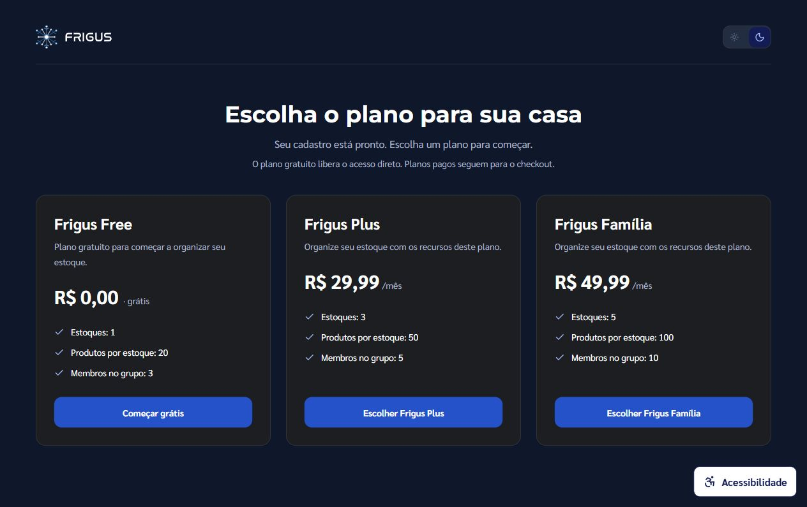
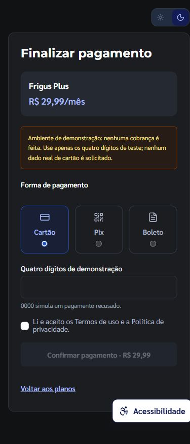

# Cadastro, escolha de plano e checkout

Implementado em 30/10/2026.

## Fluxo

1. O visitante cria a conta e escolhe o tipo: doméstico, comercial ou empresarial.
2. O cadastro autentica a conta e abre a seleção de planos do tipo escolhido.
3. Nomes, preços, periodicidade, benefícios e limites vêm de `GET /web/plans`, que consulta o catálogo ativo do Core.
4. Um plano com preço zero é ativado diretamente pelo endpoint de checkout, sem apresentar formulário de pagamento. Após confirmar a ativação no servidor, o app renova a sessão, prepara grupo/estoque e abre o painel.
5. Um plano pago abre `/checkout?plan=CODIGO`. O checkout exige confirmação antes de criar a transação. Preços recebidos pela query string são ignorados.
6. A tela de confirmação acompanha a transação do servidor. Enquanto ela está pendente, o acesso ao painel fica bloqueado no fluxo do app. Após aprovação, o usuário pode continuar para o Frigus.
7. Após recusa, cancelamento ou erro definitivo, a conta continua pendente de escolha e pode voltar aos planos.

O checkout utiliza o simulador existente no Core: cartão com quatro dígitos de teste, Pix e boleto simulados. Não foi integrado um gateway de cobrança real. O código `0000` continua simulando recusa de cartão.

## Persistência e retomada

- `User.planSelectionRequired`: novos cadastros recebem `true`; a ativação gratuita ou a aprovação do pagamento define `false` no servidor.
- `User.pendingPlanTransactionId`: identifica o pagamento em andamento. Login/restauração de sessão encaminham a conta diretamente para essa transação, evitando iniciar outro checkout pelo fluxo normal.
- Falha ou cancelamento removem somente a referência à transação correspondente; não concluem a escolha.
- AuthGuard permite seleção/checkout durante o cadastro e redireciona tentativas de abrir o painel antes da conclusão.
- Contas existentes mantêm `planSelectionRequired=false` na migração. Elas não são obrigadas a repetir o cadastro ou contratar um plano novamente.
- O grupo e o estoque inicial são preparados após a ativação. A restauração da sessão também prepara o espaço, cobrindo quem fecha o navegador depois da aprovação. A preparação pode ser repetida se o grupo existir sem estoque após uma falha parcial.

## Planos por tipo

| Tipo de conta | Códigos apresentados, quando ativos no catálogo |
| --- | --- |
| Doméstico | FREE, PLUS, FAMILY |
| Comercial | FREE, COMMERCIAL |
| Empresarial | FREE, ENTERPRISE |

O FREE é o plano básico já suportado pelo backend para os três tipos; os limites exibidos são os retornados pelo servidor. O Core recusa a contratação dos planos pagos conhecidos quando incompatíveis com o tipo de conta. As antigas opções empresariais sem código de contratação foram substituídas pelo plano ENTERPRISE do catálogo.

## Arquivos principais

- Frontend: `src/components/PlanSelection/`, `src/pages/Auth/`, `src/pages/Common/Plans*`, `src/pages/Payment/`, `src/services/plan.service.ts`, `src/utils/plan.util.ts`, `src/components/AuthGuard/` e bootstrap da sessão em `src/App.tsx`.
- BFF: contrato de usuário em `src/types/user.type.ts`; as rotas de catálogo, perfil e checkout existentes já repassam os dados necessários.
- Core API: User/DTO/mapper, AuthService, UserRepository, TransactionService e TransactionProcessorService.

## Migração e execução

É necessário subir a versão atualizada do Core com a migration Flyway **V018__user_plan_selection.sql**. Ela adiciona `plan_selection_required` e `pending_plan_transaction_id` em `users`.

Ordem de publicação: aplicar a migração/subir o Core, atualizar o BFF e publicar o frontend. Flyway está habilitado por padrão no projeto. Não executar SQL manualmente em um banco que já tenha aplicado V018. A publicação e a migração no banco real não foram executadas nesta sessão.

## Verificação

- Frontend: **96 testes aprovados**, 13 testes de stack ignorados; TypeScript da aplicação e testes, ESLint e build de produção passaram.
- Core: **32 testes direcionados aprovados** em AuthServiceTest, UserMapperTest, TransactionServiceTest e TransactionProcessorServiceTest. A compilação dos testes também valida os consumidores dos DTOs alterados.
- BFF: `npm run build` passou.
- Casos cobertos: cadastro nos três tipos de conta, login pendente/concluído, retomada do pagamento, ativação gratuita, falha de ativação, seleção paga, incompatibilidade por URL, preço/nome da confirmação vindos do servidor, aprovação, recusa e erro de catálogo.
- Conferência visual: escolha de planos e checkout em desktop/celular, sem overflow horizontal nos viewports verificados. A conferência usou uma API local de teste, pois o Docker da stack estava desligado. Nenhuma conta, cobrança ou dado de produção foi criado nessa verificação.
- Não foi executada integração com Postgres/Redis reais ou gateway de pagamento. O resultado detalhado do frontend está em `onboarding-test-results.json`; os relatórios do Core estão em `.test-build/plan-onboarding/surefire-reports/` no repositório Core.

